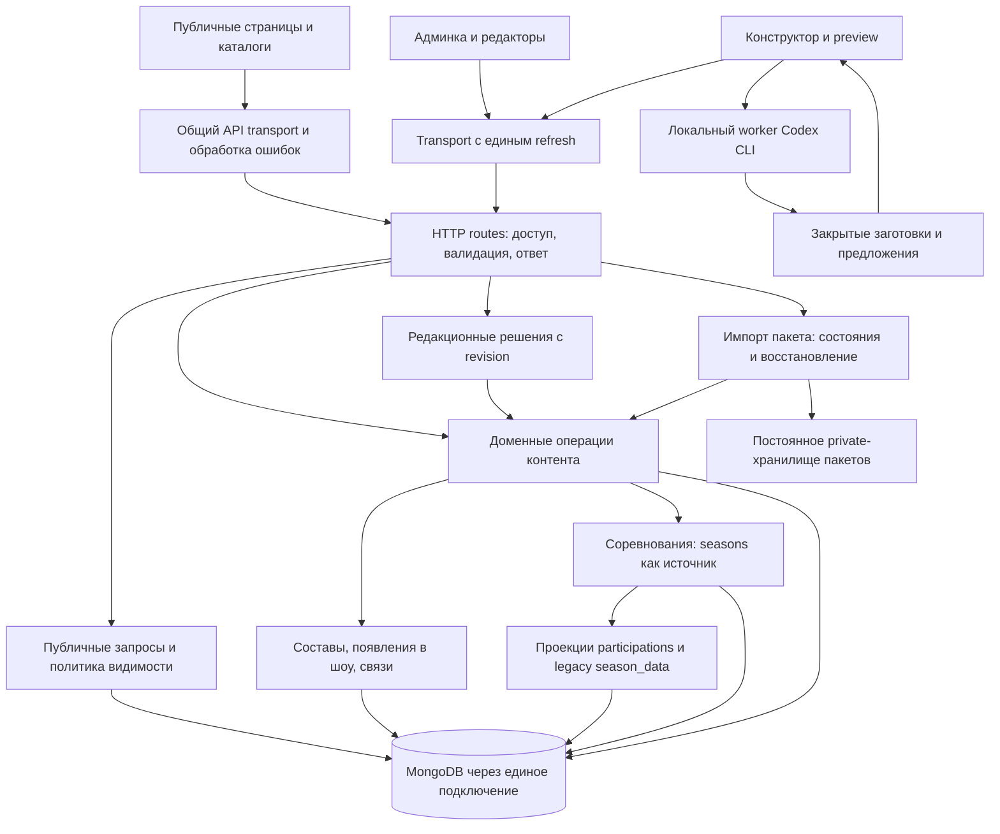
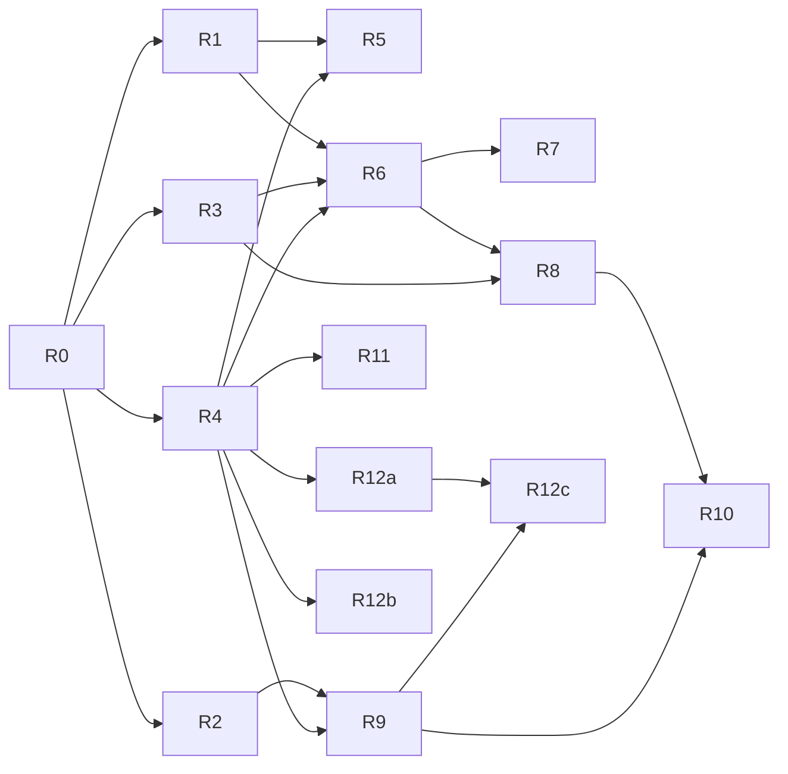

# Humorpedia: аудит проекта, схема рефакторинга и план работ

> Для исполнителя: после согласования объёма выполнять отдельные пакеты через `superpowers:executing-plans` или `superpowers:subagent-driven-development`. Этот документ фиксирует результаты аудита и рекомендуемый план; реализация, публикация и миграции в рамках аудита не выполнялись.

**Цель:** снизить риск потери данных и регрессий при дальнейшем развитии энциклопедии, редакторских инструментов и конструктора страниц.

**Архитектура:** сохранить модульный монолит FastAPI + MongoDB и React. Выделять общие доменные операции из HTTP-маршрутов, постепенно закрепить единственный источник данных соревнований, унифицировать публичное чтение и обработку запросов. Менять структуру небольшими совместимыми инкрементами.

**Стек:** Python 3.11, FastAPI, Pydantic 2, Motor/PyMongo, MongoDB 8.0.32; React 19, React Router, CRA/CRACO, Tailwind/Radix, TipTap; Docker, PowerShell, GitHub Actions; локальный Python worker с Codex CLI.

**Основание:** текущий код, проверки ниже, [CLAUDE.md](../../../CLAUDE.md), [контракт модулей](../MODULE_CONTRACT.md), [модель соревнований](../COMPETITIONS.md), [конструктор](../PAGE_BUILDER.md). Требования к сохранению поведения приведены в разделе 5.

Дата: **21.10.2026, Europe/Moscow**. Ветка: `codex/local-page-builder`. HEAD до существующих незакоммиченных изменений: `1813cf02f08c9aa202e01167c2d3eb6886ab753c`.

Статус исходного аудита: **аудит и план подготовлены; на момент снимка работы по плану не были начаты**. Remote `main` проверен через GitHub compare: совпадал с этим HEAD, ahead/behind = 0/0. В начале аудита `git status` показывал 47 изменённых/неотслеживаемых путей, включая каталоги. Они принадлежали предыдущей работе и были сохранены.

**Обновление 21.10.2026:** исходный выпуск оформлен четырьмя коммитами, HEAD `50c397b`. После их ревью локально исправлены F1–F3; результаты и ограничения — в [отчёте первого пакета](initial-refactoring-fixes-2026-10-21.md). Дальнейшая декомпозиция, общий API base, защита устаревших записей сезона и подготовка VPS остаются в плане. Разделы 1–5, 7 и 8 сохраняют факты исходного аудита; текущий прогресс отмечен ниже.

**Продолжение 21.10.2026, исходный HEAD `405f05f`:** F1–F3 и гонка ZIP опубликованы; поверх этого HEAD выполнены общий API base (R2), обязательная версия HTTP-записи сезона (R3) и основные CI-проверки R4. Каждый пакет включает код и документацию отдельным коммитом. Ручная приёмка сессии, браузерный CI smoke и GitHub Actions остаются открытыми. Подробные результаты — в том же отчёте.

## 1. Оценка проекта

Проект уже обладает работающим функциональным ядром и существенным набором проверок. Наибольший риск дальнейшего развития сосредоточен в согласованности данных и границах подсистем: старый и новый форматы сезонов, ручное редактирование и автоматический импорт, публичная видимость и административный доступ. Полная смена стека из обнаруженных проблем не следует.

**Рекомендуемый порядок:** исправить воспроизведённые ошибки → закрепить проверки выпуска и хранения данных → выделить доменные операции → завершить переход соревнований → упростить редакторы и публичный рендеринг. Обновление Node и драйвера Mongo вести отдельными небольшими изменениями.

| Область | Оценка и действие |
|---|---|
| Основные страницы, каталоги, поиск | Работают; уже есть фильтры, вложенные URL, контекстные карточки и lazy loading. Нужны единый транспорт и дальнейшая проверка качества поиска на редакционном наборе запросов |
| Люди, команды, шоу, география | Модель расширилась связями и несколькими сценариями редактирования. Главный пробел — непоследовательная политика архивирования |
| Соревнования и сезоны | Наиболее значимый архитектурный долг: фактически два изменяемых представления одной сущности |
| Модули и редакторы | Общий реестр и контрактные тесты — хорошая основа. Владельцы рендера и сериализация распределены между крупными компонентами |
| Редакционные очереди | Полезный контролируемый процесс, но конкурентные решения требуют отдельной проверки и версии документа |
| Конструктор и ZIP-перенос | Хорошо проработаны приватность заготовок, ревизии, ручная редактура и повтор импорта. Перед выпуском важны эксплуатационная готовность и восстановление после частичных сбоев |
| Рейтинги, опросы, квизы, предложения исправлений | Есть реализации и тесты. Публичный вход и пользовательские сценарии опросов остаются отдельным продуктовым вопросом |
| Доставка и эксплуатация | Local-first Docker проверен и полезен. CI не запускает все уже существующие проверки; VPS-манифест ещё не готов к новому хранилищу пакетов |
| Документация | Краткий индекс развивается, но часть справочников сохраняет устаревшие утверждения. Планировать по текущему коду |

Инвентаризация исходников и тестов: `backend` — 167 Python-файлов, 33 616 строк; `frontend/src` — 215 JS/JSX/TS/TSX-файлов, 37 752 строки. Это физические строки, включая тесты, комментарии и скрипты в backend, а не оценка сложности. Аудит охватил архитектурные контуры всего проекта; он не является построчным ревью каждого файла.

## 2. Последние функциональные обновления учтены

| Функциональный блок | Фактическое состояние | Последствие для плана |
|---|---|---|
| Перенос MODX: люди, шоу, команды, города, статьи, новости, квизы, медиа и старые адреса | Код в текущем HEAD; отдельные импорты и восстановление медиа | Сохранять совместимость URL и модулей; импорты оставить отдельными управляемыми операциями |
| Соревнования, составы, карьера, участие в шоу, проекты участников команд | В HEAD; `seasons`, `participations`, `memberships`, `show_appearances` | Разделять фактическое участие, составы и обычные появления в шоу; не объединять их в одну универсальную связь |
| Контракт модулей, рейтинг, опросы, рекомендации, связанные новости | В HEAD; реестр синхронизируется, появились настройки и тесты | Сохранить специальные правила и пользовательские результаты при декомпозиции |
| Поиск, алфавит, структурированные фильтры каталогов и сортировка | В HEAD, включая объединённый PR #55; каталог команд проверен в браузере | Старый план «добавить фильтры» уже не соответствует состоянию проекта |
| Предложения исправлений и очередь модерации | В HEAD | Проверить конкуренцию решений, не смешивать с автоматической правкой текста |
| Редакционные предложения по комикам, карточки шоу, новые сезоны и результаты | В HEAD через объединение веток и PR #55 | Закрепить идемпотентность применения и сохранность редакторских решений |
| Нормализация кавычек | В HEAD через PR #57 | Код миграции и факт применения к конкретной базе — разные вещи; не запускать повторно автоматически |
| MongoDB 8, Docker hooks и синхронизация ветки со стендом | В HEAD, PR #55/#56; runtime проверен | Сохранить защиту общей базы, запрет автоматического reset/stash и управление единственным стеком |
| Локальный конструктор: факты → Codex CLI → предложение → ручная редактура → preview | Есть в незакоммиченном рабочем дереве; unit/worker-проверки повторены | Рассматривать как отдельный готовящийся выпуск; не считать уже доставленным в main или на VPS |
| ZIP: preflight, файлы, связи между разными БД, применение и повтор | Есть в незакоммиченном дереве; 9 интеграционных тестов повторены | Проверить постоянное private-хранилище, прокси, backup и конкурентное восстановление |
| Тестовый VPS и HTTPS | Есть отдельные файлы развёртывания и документация | В этом аудите VPS не опрашивался; локальная проверка не подтверждает его текущее состояние |

Источники истории: [PR #55](https://github.com/AMnEPka/humorpedia/pull/55), [PR #56](https://github.com/AMnEPka/humorpedia/pull/56), [PR #57](https://github.com/AMnEPka/humorpedia/pull/57), Git history и рабочий diff. Старые ветки вне текущего дерева отдельно не объединялись.

## 3. Конкретные находки

Приоритеты: **P1** — исправить до расширения или выпуска затронутого сценария; **P2** — плановый долг; **P3** — развитие по продуктовой ценности. Подтверждённые дефекты отделены от рисков, которые ещё требуют воспроизведения.

### F1. P1: политика архивирования не действует единообразно

Исправлено локально 21.10.2026: общая проверка прав, списки, связанные данные и изоляция публичных кэшей; 354 случая в матрице маршрутов. Ниже — исходное воспроизведение.

Новый `content_visibility` применяется к людям, командам и шоу, но общий `get_by_id_or_slug` не фильтрует статус. Роуты статей, новостей и wiki возвращают полученный документ без дополнительной проверки. На подставной БД через реальный FastAPI router получено:

```text
GET /api/content/articles/hidden?raw=true → 200, status=archived
GET /api/content/news/hidden?raw=true     → 200, status=archived
GET /api/content/wiki/hidden             → 200, status=archived
```

Отдельно `_add_show_context` вызывает `attach_show_info` без фильтра статуса: у публичной команды остаётся `show.title/full_path` архивного шоу, хотя breadcrumbs уже пусты. Это также воспроизведено на синтетических данных.

Источники: [crud.py](../../../backend/services/crud.py), `get_by_id_or_slug`, около строки 419; [content_articles.py](../../../backend/routes/content_articles.py), `get_article`; [content_news.py](../../../backend/routes/content_news.py), `get_news_item`; [content_wiki.py](../../../backend/routes/content_wiki.py); [content_teams.py](../../../backend/routes/content_teams.py), `_add_show_context`; [show_teams.py](../../../backend/services/show_teams.py), `attach_show_info`. У городов и квизов также видны незащищённые статусом пути чтения; вся матрица маршрутов нужна в R1.

**Следствие:** существующее правило «скрывается только archived» не обеспечивается на всех путях. Нужна общая политика чтения, включая `raw`, списки, связи и кэш; статус `draft` при этом сохраняет нынешнюю публичную семантику.

### F2. P1: очередь запросов при отказе refresh остаётся незавершённой

Исправлена очередь refresh, добавлены шесть регрессионных тестов. Общий API base и redirect lookup реализованы последующим локальным пакетом R2; результаты приведены в отчёте первого пакета. Ниже — исходное воспроизведение.

В [admin/utils/api.js](../../../frontend/src/admin/utils/api.js), строки 81–116, ожидающие запросы имеют только callback успеха. При неудаче refresh первый запрос отклоняется, остальные не получают ни результат, ни ошибку; очередь не очищается. Синтетический запуск текущего interceptor с двумя 401 дал `first=rejected, second=pending`. Редирект на login выполняется и обычно маскирует проблему, но не делает транспортный контракт корректным. Повторный запрос подписчика также не помечается `_retry`.

**Следствие:** нужен один общий результат refresh для всех ожидающих запросов, ограничение повтора и тесты отказа/сети/повторного 401. Одновременно есть отдельный обход общего API-клиента: [SectionDetailPage.jsx](../../../frontend/src/public/pages/SectionDetailPage.jsx), строки 15, 118, использует только build-time URL для redirect lookup, тогда как обычный клиент поддерживает `window.__BACKEND_URL__` и proxy. Сбой на VPS в этом аудите не воспроизводился.

### F3. P1: legacy round-trip сезона теряет `person_id`

Исправлено преобразование `person_id` и проверена сервисная цепочка `save_season(write_page=True)` → страница → `sync_from_kvn_page`. Последующий R3 добавил обязательную версию HTTP-записи и проверил оба API; единый writer и атомарность между коллекциями остаются в R8. Ниже — исходное воспроизведение.

[competitions.py](../../../backend/services/competitions.py), `legacy_to_season` и `season_to_legacy`, не сохраняют привязку человека в результате игры через старое представление. Проверка на существующей fixture: добавить `person_id='person-probe'` → `season_to_legacy` → `legacy_to_season` → `person_id=None`.

KVN PUT принимает целый `season_data`, затем `sync_from_kvn_page` заменяет документ сезона через `save_season`. Обратный API сезона также пишет копию в страницу. Поэтому обычное последующее сохранение старым редактором может затереть данные нового формата. Установлен дефект преобразования; наличие уже потерянных пользовательских записей не проверялось.

**Следствие:** сначала защитить round-trip/отказ от несовместимого сохранения, затем завершать переход к `seasons` как единственному источнику. Не переносить старую форму на новый API без проверки сериализации.

### F4. P1 для выпуска пакетов: deployment ещё не соответствует новой функции

В [scripts/vps-test/compose.yml](../../../scripts/vps-test/compose.yml) нет постоянного `PAGE_PACKAGE_DIR` и mount для него. В cloud-шаблоне они уже есть, но это другой манифест. Новые опубликованные изображения пакетов находятся именно в private-каталоге, и потеря файлов при пересоздании контейнера оставит ссылки в БД без содержимого.

В [nginx.conf тестового VPS](../../../scripts/vps-test/nginx.conf) `client_max_body_size 20m`, а [page_packages.py](../../../backend/services/page_packages.py) допускает ZIP до 50 MiB. Без согласования ограничения часть корректных по API пакетов будет отклоняться прокси. Проверен исходный конфиг, а не установленная конфигурация сервера.

**Следствие:** подготовить согласованный лимит, постоянное хранилище, backup вместе с БД и restore-проверку до выкладки нового импорта. Обычный `backup/backup.sh` архивирует только MongoDB и не является полной копией сайта с медиа.

### F5. P1/P2: CI пропускает важные уже имеющиеся проверки

[tests.yml](../../../.github/workflows/tests.yml) запускает backend pytest и frontend Jest, проверяет реестр модулей. Но `PAGE_PACKAGE_INTEGRATION` не установлен, поэтому 9 интеграционных тестов пропускаются. Нет production build, Windows worker suite и проверки PowerShell dev-workflow. Это установленный пробел конфигурации, а не утверждение о красном текущем CI.

### F6. P2: создание контента и импорт зависят от HTTP-слоя

[page_package_import.py](../../../backend/services/page_package_import.py), `_create`, импортирует `create_person_record/create_team_record/create_show_record` из `routes`. Редакционные предложения тоже импортируют `_link_person_everywhere` из роутера. Доменные операции смешивают запись документа, теги, связи и производные данные.

**Следствие:** изменение HTTP-маршрута может повлиять на ZIP и редакционный процесс. Выделить application services с явными входами, а маршрутам оставить авторизацию, валидацию и HTTP-ответ. Не создавать универсальный ORM или абстракцию всей MongoDB.

### F7. P2, проверяемые риски: конкуренция решений и длительный apply

`editorial_proposals._persist_proposal_progress` обновляет весь progress по `_id` без ревизии; два редактора могут сохранить разные решения поверх одного снимка. У пакетного импорта есть lease на 5 минут, но продления/fencing не видно: старый исполнитель после истечения lease потенциально пересекается с новым. Текущие тесты повторов не доказывают корректность всех таких interleaving.

Существующие механизмы сильные: CAS заготовок, snapshots, hash/manifest, закрытая промежуточная страница, резервирование сущности, журнал шагов, защита ручных правок. Рефакторинг должен сохранить их. Сначала добавить управляемые конкурентные и fault-injection проверки; затем менять только воспроизведённые слабые места.

### F8. P2: крупные компоненты объединяют разные пользовательские операции

`SeasonDataEditor.jsx` — 2689 строк, `ModuleEditor.jsx` — 1076, `SectionDetailPage.jsx` — 879, `TeamDetailPage.jsx` — 710; backend `content_teams.py` — 1320, `content_kvn.py` — 1273. Основание для разделения — смешение загрузки, преобразований, редактирования, специальных блоков и side effects, а не размер сам по себе.

В detail-страницах людей/команд/шоу есть собственные renderers наряду с общим `ModuleRenderer`. Контракт уже централизован, поэтому нужно уточнить владельцев и извлечь действительно общие блоки. Исключения сезонов и квизов сохранять явно. Новый конструктор не стоит переписывать целиком: его важные сценарии уже покрыты, а preview переиспользует публичные страницы.

### F9. P2: есть дорогие пути, но их влияние ещё не измерено

`find_adjacent_seasons` вызывается на cache miss `/kvn/by-path` и имеет многошаговый regex fallback; это не каждый запрос и не прямой `/kvn/{id_or_slug}`. Смена slug команды сканирует KVN-страницы с `season_data`. Обычная синхронизация сезона загружает справочники команд и людей. Рекомендации собирают несколько пулов кандидатов для каждого включённого типа.

Источники: [content_kvn.py](../../../backend/routes/content_kvn.py), `find_adjacent_seasons`; [content_teams.py](../../../backend/routes/content_teams.py), `update_team`; [competitions.py](../../../backend/services/competitions.py), `sync_from_kvn_page`; [recommendations.py](../../../backend/services/recommendations.py). Нужны `explain`, количество запросов и замеры холодного/прогретого пути. Добавление Redis, новой БД или индексов наугад сейчас не обосновано.

### F10. P1/P2: жизненный цикл платформы и эксплуатационная наблюдаемость

- Node 20 стоит в CI и Docker frontend; runtime показал `v20.20.2`. Поддержка ветки закончилась 30.04.2026. Перейти на поддерживаемую LTS, рекомендуемый консервативный кандидат — Node 24, проверив зависимости. [Официальный график Node.js](https://github.com/nodejs/Release).
- Motor 3.7.1 используется в [database.py](../../../backend/utils/database.py). По актуальному README проекта после 14.05.2026 остаются только критические исправления, окончание поддержки — 14.05.2027. Планировать переход на PyMongo Async с интеграционными проверками; это не миграция данных MongoDB. [MongoDB Motor](https://github.com/mongodb/motor), [руководство миграции](https://www.mongodb.com/docs/languages/python/pymongo-driver/current/reference/migration/).
- CRA находится в maintenance mode и не имеет активных сопровождающих; его смена полезна отдельным техническим инкрементом после фиксации контракта сборки. [Официальное сообщение React](https://react.dev/blog/2025/02/14/sunsetting-create-react-app). Это не требует перехода сайта на Next.js или полной переписи React.
- `/api/health` возвращает статический `healthy`; `CacheSync` при проблемах Mongo оставляет локальный кэш, ошибки индексов логируются. Такой endpoint подтверждает жизнь процесса, но не готовность хранилища. Нужны отдельная readiness-проверка и явное состояние обязательных индексов/private storage.
- Production Dockerfile ставит `gunicorn` без версии, базовые образы частично плавающие; dev Dockerfile допускает unauthenticated apt. Это задачи воспроизводимости и доверия сборке, без утверждения о найденной эксплуатации.

### F11. P2/P3: опубликованный контент и поисковое представление требуют отдельного контроля

В текущем локальном UI главная показывает демонстрационные новости `demo-related-news-*`. Это установленный факт локальной базы, не заявление о production. Перед переносом базы нужен отчёт о демонстрационных/служебных документах; автоматическое удаление по совпадению слова недопустимо.

`frontend/public/index.html` содержит `lang="en"`; `usePageTitle` меняет только `document.title`. В просмотренном публичном коде не найден общий вывод meta description, canonical и Open Graph из редакторских SEO-полей. Это пробел публичного представления и доступности, а не причина начинать большой SSR-переезд. SEO и серверные редиректы следует проектировать отдельно от внутренней декомпозиции, если органический поиск — приоритет выпуска.

### F12. P2: прежний список техдолга частично вводит в заблуждение

[KNOWN_ISSUES.md](../KNOWN_ISSUES.md) всё ещё содержит «Frontend: нет автотестов; CI проверяет только бэкенд», а видимость draft описывает как баг, хотя актуальное соглашение считает draft публичным. [ARCHITECTURE.md](../ARCHITECTURE.md) говорит о единственном локальном стенде, тогда как индекс уже описывает отдельный тестовый VPS. Исправить актуальные утверждения и оставить исторические цифры с датой, не переносить их в новую оценку как текущие.

## 4. Схема целевого рефакторинга



Это схема зависимостей внутри текущего приложения, не набор новых микросервисов. Новые файлы ниже — предлагаемые границы; существующие URL и форматы ответа сохраняются. Не следует создавать пустые универсальные слои заранее.

| Текущий узел | Целевая граница | Что остаётся совместимым |
|---|---|---|
| `routes/content_people.py`, `content_teams.py`, `content_shows.py` | `services/content_commands.py`: существующие операции создания/связей с теми же сигнатурами | CRUD API, slug/full_path, ручные поля и побочные доменные действия |
| Фильтры статуса в отдельных routes | Расширенный `services/content_visibility.py` и явная передача редакторского контекста | `draft` публичен; `archived` доступен editor/admin, не анониму |
| `kvn.season_data` ↔ `seasons` | Один путь записи в `seasons`, legacy adapter только для совместимости | Старые данные, URL сезонов, игры, роли, комментарии, порядок результатов |
| `ModuleRenderer` в нескольких detail-компонентах | Реестр владельцев + общие renderer-компоненты; специализированные секции отдельно | Контракт модулей, TOC, системные блоки, специальные сезоны/квизы |
| Крупные формы сезонов и модулей | Контроллер операции + формы этапа/игры/результата; явная сериализация | DnD, неизвестные legacy-поля, сохранение/повторное открытие |
| Import и editorial state transitions | Отдельные сервисы переходов, версии и владение выполнением | Пакет v1, ревизии, идемпотентность, ручная проверка и повтор после сбоя |
| Dev / cloud template / VPS files | Явная матрица окружений и проверяемый release manifest | Один локальный стек; отдельная VPS-база; отсутствие автоматических миграций |

## 5. Ограничения будущей реализации

- Сохранить русскоязычный UI, публичные адреса, `old_urls`, формы API и контракт модулей.
- Сохранить текущую политику статусов: обычный `draft` публичен, `archived` скрыт. Заготовки конструктора остаются в отдельных закрытых коллекциях.
- Сохранить ручную редактуру, исторические подписи, неизвестные совместимые legacy-поля, составы и связи. Рейтинги не должны раскрывать точные публичные счётчики.
- Не смешивать обычные появления в шоу с турнирными результатами; `participations` остаются производными.
- Worker остаётся локальным; генерация не публикует страницу. Перенос — preflight и отдельное явное применение ZIP.
- Не менять БД на MySQL, не вводить микросервисы, Redis, новый UI-kit или массовый TypeScript в рамках этого плана без отдельного измеримого основания.
- Сохранять существующее dirty-дерево. Перед реализацией зафиксировать исходный выпуск с владельцем изменений; не применять автоматический stash/reset/clean, не создавать ветку с потерей незакоммиченных файлов.
- Для миграций — dry-run, копия исходных значений, повторяемость, тест на отдельной БД. Общую `mongo_data` не использовать как тестовую.
- После изменений зависимостей/Docker выполнять полный `dev-sync.ps1`; merge и возврат на main — по `dev-finish.ps1`. Commit/push/deploy выполняются только в согласованном процессе.

Обязательные пограничные сценарии для review: анонимный доступ к `archived` через `raw/relations/cache`; несколько 401 одновременно; сохранение старой формы поверх расширенного сезона; авария/повтор/два импортера после истечения lease; восстановление БД вместе с private media. Каждый относится к своему пакету ниже.

## 6. План работ и зависимости

Оценки — ориентир в инженерных днях для человека, знакомого с проектом; это не обещание календарного срока и не бюджет токенов. Включают проверки и review, не включают массовое редакционное наполнение и ожидание решений.

| ID | Приоритет / результат | Зависит от | Оценка | Рекомендуемая модель |
|---|---|---|---:|---|
| R0 | Зафиксирован исходный выпуск и актуальный контекст | — | 0,5–1 | Luna / high |
| R1 | Единая видимость архивного контента | R0 | 2–3 | Sol / high |
| R2 | Предсказуемый API transport и refresh | R0 | 1–2 | Luna / high |
| R3 | Защита данных сезона при legacy round-trip | R0 | 1–2 | Sol / high |
| R4 | CI проверяет реальный выпуск | R0 | 1–2 | Luna / high |
| R5 | ZIP готов к deployment и восстановлению | R1, R4 | 2–3 | Sol / high |
| R6 | Создание контента вынесено из routes | R1, R3, R4 | 3–5 | Sol / high |
| R7 | Конкурентные решения и восстановление импорта | R6 | 2–4 | Sol / high |
| R8 | Один источник записи соревнований | R3, R6 | 4–6 | Astra / high для схемы перехода; Sol / high для кода |
| R9 | Единые владельцы рендера и простые detail-страницы | R2, R4 | 2–4 | Sol / high |
| R10 | Редакторы разделены по операциям | R8, R9 | 3–5 | Sol / high |
| R11 | Измерены и устранены подтверждённые узкие места | R4; синхронизация с R8 | 2–4 | Sol / high |
| R12a | Поддерживаемый Node и воспроизводимая сборка | R4 | 0,5–1 | Luna / high |
| R12b | PyMongo Async вместо Motor | R4; не одновременно с R8 | 2–3 | Sol / high |
| R12c | Поддерживаемый сборщик вместо CRA | R2, R4, R9, R12a | 2–4 | Sol / high |
| R13 | Поисковое представление и контентная готовность | Отдельный продуктовый приоритет | 3–6 | Sol / high |

Здесь Luna = `gpt-6-luna`, Sol = `gpt-6.1-sol`, Astra = `gpt-6-astra`. Это рекомендации для будущих пакетов, не изменение модели текущего чата. По умолчанию один исполнитель; помощник Luna/high — для ограниченной независимой проверки. Не делить общий изменяемый файл между агентами.



**Первый инкремент:** R0–R4 и R12a, ориентир 6–11 инженерных дней. Если следующий выпуск содержит ZIP-импорт на VPS, R5 — обязательный gate, ещё 2–3 дня. Полная техническая программа R0–R12 — примерно 28–50 инженерных дней; её разумно принимать по инкрементам, а R11 ограничивать результатами измерений. R13 и другие новые пользовательские функции не входят в эту сумму.

### R0. Зафиксировать исходное состояние

- [x] Составить release manifest текущего dirty-дерева: конструктор/ZIP — `a7904ce`, VPS — `5baf21a`, документация — `4c43ee4`, отчёт — `50c397b`.
- [ ] Обновить только устаревшие положения `docs/ai/ARCHITECTURE.md`, `KNOWN_ISSUES.md`, `API.md` и статус конструктора; сохранить историю и отдельные даты проверок.
- [ ] Приёмка: зафиксированы ветка/HEAD, diff состава выпуска, состояние Docker, перечень миграций и gates. Изменения пользователя сохранены. Никаких автоматических действий с базой.

### R1. Закрыть все пути чтения архивного контента

**Файлы:** `backend/services/content_visibility.py`, `show_teams.py`, `crud.py`; применимые content/cities/sections/search/recommendations routes и services. Тесты: расширить `tests/test_content_visibility.py`, при необходимости отдельный `test_visibility_matrix.py`.

- [x] Зафиксировать матрицу `anonymous/user/moderator/editor/admin × draft/published/archived × list/detail/raw/relations/by-path` на реальных маршрутах; для редакторского режима требовать авторизацию, не доверять флагу клиента. Охват отдельных сочетаний указан в отчёте; это не полное декартово произведение для всех вспомогательных маршрутов.
- [x] Распространить существующие `visible_query`/`require_visible`, передавать контекст в `attach_show_info`; не менять общую семантику `draft`.
- [x] Проверить кэш обеими последовательностями: editor → anonymous и anonymous → editor; карточка архивного родителя не должна возвращаться анониму через связи.
- [x] Приёмка: воспроизведения F1 превращены в regression-тесты; аноним получает 404 для archived detail и не видит его в проверенных списках/связях, editor сохраняет доступ; обычный draft остаётся доступен.

### R2. Упростить транспорт и refresh

**Файлы:** `frontend/src/admin/utils/api.js`, `public/utils/api.js`, `public/pages/SectionDetailPage.jsx`. Новые: `utils/apiBase.js`, `utils/apiBase.test.js`, `public/pages/SectionDetailPage.test.jsx`, `admin/utils/api.test.js`. Контракт `utils/media.js` проверен и сохранён без изменения URL изображений.

- [x] Вынести `getApiBase()` с текущим порядком proxy → runtime config → build-time config → fallback; использовать в admin/public API и redirect lookup. Медиа сохраняет относительные/абсолютные/blob URL и не использует префикс `/api`.
- [x] Заменить очередь callback одним разделяемым Promise refresh либо очередью с resolve/reject. Любой ожидающий запрос завершается, все повторные запросы помечаются `_retry`, новый refresh после отказа возможен без старых подписчиков.
- [x] Тесты: 2 параллельных 401 + успех; отказ refresh; сеть без response; повторный 401; login/refresh не зацикливаются; runtime config при отсутствующем build URL; old URL через общий клиент. Новые проверки также покрывают завершающие слеши/path prefix, ненайденный redirect и отказ lookup.
- [x] Приёмка кода: `yarn test --watchAll=false --runInBand`, production build и браузерный переход по legacy URL на localhost. На момент R2: 247 tests / 44 suites; последующий R3/R4: 255 tests / 46 suites и строгая сборка без предупреждений ESLint.
- [ ] Ручные login/logout/истёкшая сессия в выбранном тестовом окружении. Эти действия не подменяются unit-тестами refresh.

### R3. Сохранить расширенные данные сезона

**Файлы:** `backend/services/competitions.py`, `routes/content_kvn.py`, `routes/competitions.py`, модели `KVNUpdate`/`SeasonUpdate`, `frontend/src/admin/pages/KVNEditPage.jsx`; тесты конвертера, версий и HTTP/Mongo-интеграции. Сериализация `SeasonDataEditor` проверена: `person_id` сохраняется в форме.

- [x] Добавить round-trip тест результата с `person_id`; существующие и новые проверки покрывают стабильные game/stage ID, comment, неизвестные legacy-поля, историческое название команды, нескольких победителей и отсутствующий год.
- [x] Сохранить `person_id` при преобразованиях и записи через `save_season`/`sync_from_kvn_page`, не выводя техническое поле как текст.
- [x] По решению владельца обе HTTP-записи сезона требуют `expected_updated_at`; отсутствие/устаревшее значение и проигранный CAS дают `409`. Явный `null` только для документа без версии либо с `updated_at: null`. Админка обновлена; отдельных служебных HTTP PUT-клиентов сезона не найдено. Передача свежей версии не является валидацией полноты произвольного клиентского тела; единый writer и семантика удаления остаются в R8.
- [x] Приёмка: `person-42` сохраняется после round-trip и HTTP-сохранений через оба API; остальные legacy-поля покрыты прежними fixture-тестами. Пять HTTP/Mongo-тестов проверяют последовательность двух API, сохранение данных при конфликте и оба вида старой записи. Миграций рабочих данных нет. Ручное сохранение реальной формы в браузере не запускалось; поведение формы проверено четырьмя React-тестами.

### R4. Сделать проверку выпуска воспроизводимой

**Файлы:** `.github/workflows/tests.yml`, существующие `scripts/test-dev-workflow.ps1`, `scripts/page-builder/test_worker.py`; новые smoke-тесты только для пробелов.

- [x] Добавлен `mongodb-integration` с Mongo healthcheck, `PAGE_PACKAGE_INTEGRATION=1` и `SEASON_WRITE_INTEGRATION=1`. Очистка ограничена собственными `humorpedia_package_test_*` / `humorpedia_season_test_*` базами; обе интеграции реально выполнены локально.
- [x] Добавлен Windows job для worker и dev-workflow, frontend build с `CI=true`; существующая проверка module contract сохранена. Четыре предупреждения hooks устранены адресно; найденный цикл выбора команды без списка сезона воспроизведён и исправлен. Локальные worker (16 тестов), PowerShell dev-workflow, полный frontend и строгая сборка прошли.
- [x] Добавлен browser smoke `scripts/browser-smoke`: поиск → карточка → назад; редактура → iframe preview; настоящий ZIP → preflight → apply → обычная форма и публичный preview. Локально пройден в Chromium/Chrome на отдельной временной БД с production build точного HEAD; БД и контейнер после остановки отсутствуют. CI job подготовлен, hosted run ещё не выполнен. Зависимости приложения не менялись; Playwright 1.62.1 — отдельный тестовый инструмент.
- [ ] Приёмка: чистый checkout проходит полный pipeline на GitHub Actions. Локальные проверки текущего общего дерева прошли; hosted pipeline ещё не запускался. Не считать Jest проверкой файлового picker и nginx.

### R5. Подготовить эксплуатацию нового импорта

**Файлы:** `scripts/vps-test/compose.yml`, nginx-конфиги нужного окружения, `docs/deployment/vps-test-operations.md`, backup/restore tooling; `backend/server.py` для readiness.

- [ ] Добавить постоянный закрытый mount `PAGE_PACKAGE_DIR`, включить его в резервирование вместе с MongoDB и media/uploads; публичную выдачу оставить через проверяющий backend route.
- [ ] Согласовать лимит ZIP с оператором. Рекомендация — сохранить 50 MiB в API и выделить небольшой запас multipart в прокси только на маршруте загрузки; проверить ограничения всех proxy layers.
- [ ] Разделить liveness и readiness: Mongo ping с таймаутом, обязательные индексы, доступность нужного private storage. Тест отказа каждой зависимости не должен менять рабочий стек.
- [ ] На отдельной цели проверить перезапуск контейнера, импорт с фото, отказ в приватном media до публикации и restore БД+файлов. Сверить SHA-256 и открытие картинки после восстановления.
- [ ] Приёмка: манифест, лимиты, резервирование и smoke согласованы; факт выкладки записывается отдельно. Подготовка этих файлов сама по себе не означает разрешение deploy.

### R6. Выделить доменные операции создания и связывания

**Создать:** `backend/services/content_commands.py`, `tests/test_content_commands.py`. **Изменить:** `content_people/content_teams/content_shows`, `editorial_proposals`, `page_package_import`.

- [ ] Сначала перенести существующие `create_person_record`, `create_team_record`, `create_show_record`, `_link_person_everywhere` с сохранением сигнатур и поведения. На первом шаге допустимы совместимые обёртки в routes.
- [ ] Разделить запись основного документа и явно вызываемые link/sync-операции, сохранив опции `document_id`, `defer_links`, `page_package_id` там, где они уже предусмотрены. Передача `db` должна быть явной внутри workflow.
- [ ] Перевести importer и editorial service на новые функции; устранить импорт `services → routes` для этих сценариев. Не переносить весь CRUD в новые классы ради структуры.
- [ ] Приёмка: одинаковые данные при обычном API и ZIP-импорте; прежние auth guards и 9 integration-тестов проходят; связи и кэш обновляются как раньше.

### R7. Укрепить переходы состояний

**Файлы:** `backend/routes/editorial_proposals.py`, предлагаемый `services/editorial_decisions.py`, `services/page_package_import.py`; `test_editorial_proposals.py`, `test_page_package_import.py`.

- [ ] Воспроизвести одновременные accept/reject одного change и два apply с истечением lease, используя барьеры/управляемые часы без произвольных sleeps.
- [ ] Ввести CAS/revision для редакционных решений. Для импортера выбрать продление lease с проверяемым владельцем либо fencing generation; старый исполнитель не должен продолжать запись после потери владения.
- [ ] Проверить сбой после файлов, страницы, состава, appearances, публикации и перед записью завершения. Повтор не дублирует страницу/медиа/связи и не затирает ручную правку.
- [ ] Приёмка: каждый сценарий имеет определённый результат success/conflict/retry, журнал объясняет состояние. Очистка orphan files сначала выдаёт отчёт; удаление данных — отдельная управляемая операция.

### R8. Завершить переход соревнований к одному источнику

**Файлы:** `backend/services/competitions.py`, `routes/competitions.py`, `routes/content_kvn.py`, `models/competition.py`, `frontend/src/admin/components/SeasonDataEditor.jsx`, `public/pages/SeasonDetailPage.jsx`, `docs/ai/COMPETITIONS.md`.

- [ ] На копии базы построить отчёт различий `seasons` и `kvn.season_data`. Не объявлять одну копию правильной только по её типу; конфликтующие записи требуют редакторского решения.
- [ ] Согласовать `seasons` как единственный путь записи, revision и правила обработки старого клиента. Предлагаемая точка входа — существующий API `/competitions/seasons/{id}`, legacy API становится адаптером к тому же workflow.
- [ ] Перевести редактор по частям. Проекцию `season_data` и `participations` строить из сохранённого сезона; повторное построение не меняет канонические данные. Прямую обратную замену сезона из устаревшей проекции убрать после переключения всех writers.
- [ ] Приёмка: create/edit/reorder/rename/role/person-only result проходят UI/API; два параллельных редактора получают конфликт; reconciliation после rebuild даёт нулевой diff. Возврат версии приложения сохраняет совместимую legacy-проекцию.

### R9. Упорядочить публичный рендеринг

**Файлы:** `moduleContract.json`, `public/components/ModuleRenderer.jsx`, `public/pages/{Person,Team,Show,Section}DetailPage.jsx`, существующие contract-тесты; новые общие компоненты только для реально повторяемых блоков.

- [ ] Зафиксировать владельца каждого типа: generic / system / entity / season / quiz. Backend JSON остаётся единственным редактируемым реестром.
- [ ] Извлечь общие renderer-функции и состояние загрузки; оставить отдельные доменные секции. Preview конструктора использует тот же публичный renderer.
- [ ] Приёмка: порядок, `visible`, заголовки, TOC, gallery/video, unknown module, season_data и quiz не теряются и не дублируются; страницы и preview проверены на 390 и 1120 px. Не создавать «универсальную страницу» с десятками флагов.

### R10. Разделить крупные редакторы

**Файлы:** `SeasonDataEditor.jsx`, `ModuleEditor.jsx`, `KVNEditPage.jsx`; новые `admin/components/season-editor/*` и `module-editor/*` с отдельными формами/serializer.

- [ ] Перенести чистые преобразования в функции с round-trip тестами; затем выделить операции этапа, игры, результата и конкретного module editor.
- [ ] Сохранить drag-and-drop, дублирование блока, удаление с подтверждением, неизвестные совместимые поля и факт ручной редакторской правки.
- [ ] Приёмка: открыть существующую страницу → изменить одну оценку/модуль → сохранить → открыть заново; остальные данные равны исходным. Не заменять TipTap и не добавлять новый form framework в этом пакете.

### R11. Измерить производительность и готовность

**Файлы:** запросные paths `content_search`, `catalog_filters`, `recommendations`, `content_kvn`, `content_teams`, `competitions`, `cache`; предлагаемый отдельный read-only скрипт измерений.

- [ ] Собрать baseline: cold/warm latency, число Mongo-запросов, examined/returned, ответный payload, CPU/RAM для поиска, каталога, карточки, сезона, рекомендаций. Локальные замеры и VPS-нагрузку маркировать раздельно.
- [ ] Для соседних сезонов использовать индексируемые tournament/year или карту; при смене slug читать только реально затронутые сезоны; индексы recommendations выбирать по `explain`.
- [ ] Приёмка: результаты и суточная стабильность рекомендаций прежние, запросы не растут линейно по всей базе для ограниченной правки, p95 на одинаковом наборе/окружении не хуже baseline. Целевой SLA согласовать после измерений, не выдумывать его из этого аудита.

### R12. Обновлять платформу независимыми PR

- [ ] **R12a, Luna/high:** обновить `frontend/Dockerfile`, `Dockerfile-cloud`, CI на проверенную Node 24; закрепить версию `gunicorn` и устранить unauthenticated apt в dev-образе проверяемым источником. Проверить clean build, HMR и полный `dev-sync`.
- [ ] **R12b, Sol/high:** начать с `backend/utils/database.py` и всех непосредственных Motor imports. Перевести на `AsyncMongoClient`, проверить cursor/aggregate/close, startup, индексы и pool; затем полный unit+integration. Исправить актуальные Pydantic/Query deprecations отдельным малым изменением. Не менять структуру коллекций.
- [ ] **R12c, Sol/high:** после transport/render работ заменить CRA/CRACO на поддерживаемый сборщик; рекомендуемый кандидат — Vite. Сохранить proxy `/api,/media,/images,/uploads`, alias `@`, runtime `config.js`, SPA fallback, lazy chunks и Windows HMR. Конкретную версию и совместимость выбрать в начале пакета. Jest можно оставить на первом шаге; не менять сборщик и все тесты одновременно.
- [ ] Приёмка каждого PR: существующие проверки проходят на новом runtime, локальный сайт обслуживается из правильного checkout, production assets открываются. Удаление `react-quill` и других предположительно неиспользуемых зависимостей — только после подтверждения импорта/сборки.

### R13. Отдельный продуктовый инкремент

Рекомендуется после исправления P1 или параллельно независимой командой; не маскировать его под внутренний рефакторинг.

- [ ] Решить целевой результат для поиска/индексации: metadata, canonical, карточки ссылок, sitemap, серверная обработка legacy URLs. Начать с `lang="ru"` и единого metadata-контракта; потребность SSR/prerender подтвердить требованиями к ботам и измерением.
- [ ] Перед переносом контента выполнить read-only отчёт демонстрационных документов, битых внутренних ссылок/медиа, несвязанных участников и дублей. Правки данных выполнять отдельными одобренными пакетами.
- [ ] Продолжать [существующий UX-план](public-user-experience-plan.md) с учётом уже готовых фильтров. Мобильное «Главное», избранное, недавно просмотренное, публичный login, комментарии и ранги — отдельные задачи с критериями пользовательской ценности.
- [ ] Приёмка: конкретные пользовательские сценарии и данные соответствуют согласованному результату; инженерная декомпозиция сама по себе не считается UX-улучшением.

## 7. Выполненная проверка аудита

| Проверка 21.10.2026 | Результат и границы |
|---|---|
| Git и GitHub compare | Ветка/HEAD проверены; remote main совпадает. Существующие 47 dirty/untracked путей сохранены |
| `powershell -NoProfile -ExecutionPolicy Bypass -File scripts/dev-status.ps1`; `docker compose ps` | Backend/frontend отвечают; Mongo healthy; mounts этого checkout, зависимости соответствуют sync; порты web только loopback |
| `docker compose exec -T -e PYTHONDONTWRITEBYTECODE=1 backend pytest -q -p no:cacheprovider tests` | **499 passed, 9 skipped**, 4 предупреждения. Это unit/route/contract набор; skipped — отдельная интеграция |
| `docker compose exec -T -e PYTHONDONTWRITEBYTECODE=1 -e PAGE_PACKAGE_INTEGRATION=1 backend pytest -q -p no:cacheprovider tests/test_page_package_import.py` | **9 passed**; fixture создаёт и удаляет отдельные UUID-базы, рабочая БД не служит тестовой |
| `docker compose exec -T -e CI=true frontend yarn test --watchAll=false --runInBand` | **213 passed, 40 suites** |
| `python -B -m unittest discover -s scripts/page-builder -p test_worker.py` через установленный Python runtime Windows | **16 passed**; подставной CLI, проверка реальной генерации через Codex не выполнялась |
| `node scripts/sync-module-contract.cjs --check` | Реестры совпадают |
| `docker compose exec -T -e BUILD_PATH=/tmp/humorpedia-audit-build frontend yarn build` | Успешно, exit 0; 5 предупреждений hooks в четырёх компонентах, устаревшие Browserslist data. Артефакт во временном каталоге контейнера |
| Изолированные воспроизведения F1–F3 | Подтверждены архивные ответы, незавершённый subscriber refresh и потеря `person_id`; это не исправления и не статистика инцидентов рабочей базы |
| Браузер, localhost:3000 | Главная, поиск с результатом, каталог команд с фильтрами, переход в «Азия MIX». Прочитан DOM, каталог просмотрен визуально |
| `git diff --check` | Без ошибок whitespace до и после оформления документации; локальные ссылки документа проверены |

Не проверены в этом аудите: текущий VPS/production, реальный publish ZIP через браузерный file picker, live Codex generation, вся админка с авторизацией, mobile/keyboard/screen-reader сценарии, нагрузка и restore полного backup, полная SCA/CVE-проверка зависимостей. Отдельные ошибки запуска проверок из sandbox/неверного container path устранены способом запуска; они не интерпретируются как дефекты продукта.

## 8. Решения перед соответствующими этапами

План можно обсуждать и принимать по пакетам; перечисленные решения не блокировали текущий аудит.

1. **Исходный выпуск:** какие существующие незакоммиченные изменения входят в ближайшую поставку и кто их владелец. Рекомендация — отдельно конструктор/импорт и отдельно VPS tooling; не начинать массовый рефакторинг поверх незафиксированной поставки.
2. **Соревнования:** подтвердить переход всех writers на `seasons`, обработку конфликтующих legacy-копий и совместимость старого редактора. Рекомендация соответствует уже заявленной модели, но реальное переключение требует R3 и reconciliation.
3. **Очередность развития:** если ближайшая цель — публичный запуск, R5 и контентная/SEO-готовность важнее косметического дробления компонентов. Если цель — дальнейшее расширение редакторов, после P1 раньше выполнять R6–R10.

Готовность текущей задачи: оценка всего архитектурного контура и последних обновлений выполнена; схема, приоритеты, зависимости, модели, проверки и границы реализации записаны здесь. Код приложения не рефакторился, commit/push/deploy не выполнялись.
