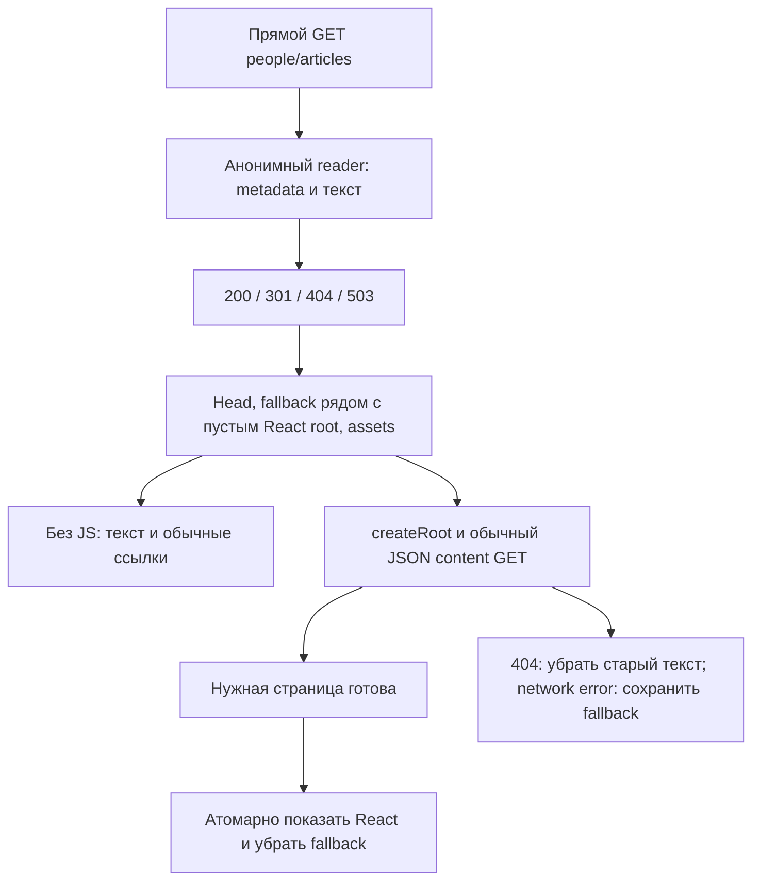

# R13c: готовность контента и схема HTML + React

Дата:22.10.2026 (МСК). Worktree `C:/Users/rdp6126443.gmail.com/.codex/worktrees/r5-zip-operations/humorpedia`; ветка `codex/local-page-builder`, HEAD до изменений R13c `fa9342de7511376d2251ebbf13cdb0102b8d832a`.
Статус:read-only инвентаризация и проверка R13b на копии реальных данных завершены; схема A согласована пользователем; подготовлен [план следующего изолированного пилота R13d](r13d-html-react-pilot-plan-2026-10-22.md). Приложение/данные/маршрутизация не изменяются; документация R13c включена в пакет R13d по поручению пользователя.
Основной агент:данные/интеграция/документ; один помощник:независимое исследование React/bootstrap. Рекомендуемые модели:Sol/high для ограниченного пилота; Astra/high для ревью общей схемы.

## Публикация R13b

R13b с документацией опубликован отдельным коммитом **fa9342de7511376d2251ebbf13cdb0102b8d832a** в `origin/codex/local-page-builder`; remote ref совпал. Перед commit повторно49 unit/API PASS, staged20 файлов проверены; primary main/HTTP/compose сохранены.

[GitHub CI39764690989](https://github.com/AMnEPka/humorpedia/actions/runs/39764690989) на точном SHA: **completed/success, все пять jobs success** — backend, mongodb-integration (включая новый HTML pilot integration), frontend, windows-tools, browser-smoke. Этот run проверяет R13b, а не незакоммиченную документацию R13c.

## Источник и метод

Цель — продолжение [пилота R13b](r13b-fastapi-html-pilot-plan-2026-10-22.md) для индексации/превью с canonical origin `https://humorpedia.ru`. Источник — локальная Mongo `humorpedia` стенда `main ca46155`. Временный MongoClient выполнял только find/getMore по allowlist people/articles/teams/shows/news/kvn/quizzes/wiki/cities/sections. Users, очереди24СМИ/редакции, site_settings и секреты не читались. Основной backend не перезапускался, production lifecycle/API не вызывались.

Для people/articles выбраны status/адресация/SEO/modules/excerpt/content/медиа/notices; для прочих — только status/адресация/id/show_id/old_id/title, нужные для инвентаризации и разрешения ссылок. Начальный снимок адресов дополнен old_id/show_id до запуска настоящего LinkResolver на копии. В окончательном экспорте20 find +10 getMore и **0 команд записи**. SHA256 канонического Extended JSON выбранных полей совпали в двух последовательных чтениях всех10 коллекций. Это не транзакционный snapshot и не доказательство неизменности невыбранных полей всей БД.

Raw content и одноразовые исследовательские скрипты остаются в ignored `.cache/r13c/`; в Git — агрегаты и публичные URL-примеры. Основные артефакты: `manifest.json` (точные hashes/время), `content-snapshot.jsonl`, `audit.json`, `findings.json`, `images.json`, `real-html.json`. Никакого обращения к VPS/боевому домену.

## Инвентаризация

| Тип | Всего | published | draft | archived | missing/unknown status |
|---|---:|---:|---:|---:|---:|
| people | 1041 | 1039 | 0 | 2 | 0 |
| articles | 66 | 66 | 0 | 0 | 0 |
| teams | 1310 | 635 | 675 | 0 | 0 |
| shows | 257 | 253 | 4 | 0 | 0 |
| news | 1018 | 1018 | 0 | 0 | 0 |
| kvn | 152 | 150 | 2 | 0 | 0 |
| quizzes | 11 | 11 | 0 | 0 | 0 |
| wiki | 0 | 0 | 0 | 0 | 0 |
| cities | 56 | 56 | 0 | 0 | 0 |
| sections | 0 | 0 | 0 | 0 | 0 |
| **Всего** | **3911** | **3228** | **681** | **2** | **0** |

People/articles:1107 документов,1105 published и2 archived. Пустых/повторяющихся slug нет; metadata builder построил значения для1107, но archived остаются404. У всех1105 published основной извлечённый текст непустой.

В teams45 и shows21 повторяющихся значений последнего slug. Настоящие URL_BUILDERS/full_path/team_url дают **0 коллизий канонических путей published-документов** во всех8 проверенных типах. Повтор slug иерархической страницы сам по себе не ошибка; данные не переименовывались.

681 draft по согласованной политике остаются читаемыми через прежние правила, но не индексируются. Массовое изменение статуса ради sitemap не входит в задачу.

### Покрытие первого среза

| Основные модули | people | articles |
|---|---:|---:|
| text_block | 1657 | 212 |
| timeline с непустыми events | 1039 | 0 |
| quote | 0 | 1 |
| image первым visible модулем статьи | — | 15 |

У1039 людей также есть sidebar poster_photo/facts_table/rating_widget/tags_cloud/social_links: они не должны становиться основным текстом HTML. В данном снимке нет visible legacy text, timeline content/content_html/period, collapsed text, explicit anchor_id, скрытых/неизвестных типов или unsupported body после исключения sidebar/article header image. Это покрытие конкретных данных; поддержку других форм из React/редактора не удалять, synthetic cases остаются в следующей матрице.

12 страниц людей и2 статьи содержат старую текстовую подпись об иноагенте; у4 людей собственный foreign_agent=true. Встроенные подписи сохраняются. Специальных annotated notices в выбранном сыром тексте не найдено; это не правовая проверка списка людей.

В13 документах есть сырые ссылки /people/... без точного совпадения slug. Это кандидаты на редакционную сверку, **не13 подтверждённых404**: общий LinkResolver умеет old_urls/pattern и превращает отсутствующую цель в текст.

### SEO и изображения

- Meta title заполнен у1039 published людей/66 статей; explicit description —1003/66. Для36 людей применяется согласованный нейтральный fallback. У людей3 группы одинаковых итоговых title; по одной группе одинаковых description у людей/статей. Это редакционные кандидаты на различение, не доказанные дубли сущностей; canonical уникальны.
- **13 published страниц без подходящего своего image**:3 человека/10 статей. Тестовый1×1 PNG R13b не является production share image. Нужен общий публичный fallback, например1200×630 на существующем бренде, с проверкой URL/content-type.
- 1091 уникальный выбранный локальный путь соответствует1092 документам с собственным image. Read-only проверка разрешённых /app/media,/app/images,/app/uploads:1082 файла присутствуют, **9 отсутствуют**; ошибок заголовка изображения у присутствующих нет. Проверялись локальные файлы, не VPS/production HTTP.
- Все9 отсутствующих выбранных файлов относятся к published людям. Примеры: `/people/roman-davydov`, `/people/svetlana-prihodko`, `/people/dmitry-arefiev`. Перед выпуском — отдельное восстановление файлов либо выбор проверенного fallback; R13b проверяет синтаксис URL, не наличие файла.
- У6 выбранных изображений одна сторона меньше200px (150×210…300×168). Это сигнал качества preview, не заявленный стандарт/HTTP-ошибка. Изображения/SEO не переписывались.

## Проверка R13b на копии реальных данных

В отдельной сети `humorpedia-r13c-audit` — Mongo8.0.32 без опубликованных портов/primary volumes. Собственная пустая UUID БД содержит3911 projected records и owner marker. Приложение — неизменённая app factory R13b; primary Mongo больше не используется.

HTTPX/ASGI выполнил **1107 GET**: people1039×200 +2×404, articles66×200. Ошибок/неожиданных статусов0.1105 ответов индексируемы только при явном indexing flag; head/robots/no-store корректны. Полные BSON hashes всех коллекций копии до/после GET совпали. Команд записи при GET нет; штатный cleanup проверил owner marker и удалил UUID БД.

**9686 find, в среднем8.75 чтения/GET**, с последовательно прогревающимся process-local link cache. Два чтения в R13b относились к простым synthetic fixtures; cross-links требуют дополнительных batch queries. Это счётчик команд, не latency benchmark/production p95. Повторный JSON GET после HTML добавляет работу; она зависит от cache/worker.

Не проверялись:полная browser parity1105 страниц, редакционная достоверность/права, remote URLs, контент остальных типов и production нагрузка. JS-off/parity smoke и green CI R13b — отдельные свидетельства.

## Предложение для следующего изолированного пилота

Пользователь согласовал схему A 22.10.2026. Варианты B/C сохранены как рассмотренные альтернативы; их реализация не поручена. Первый охват — people/articles; собственный тестовый gateway/стенд, без изменения primary Compose/nginx.

| Вариант | Преимущество | Цена |
|---|---|---|
| **A. HTML fallback + createRoot + штатный JSON GET — рекомендую первым** | Публичные страницы/счётчик просмотров/виджеты сохраняют нынешний путь; без bootstrap payload и нового view-протокола | Повторное чтение, ожидание React и явное согласование head |
| B. HTML fallback + публичный bootstrap DTO | Убирает первый повторный content GET | Allowlist DTO, safe JSON embedding и новый совместимый учёт просмотров |
| C. React SSR + hydrateRoot | Может дать точное первое React-дерево | SSR-сборка/runtime, server-safe pages/data loaders; скорость здесь не измерялась |

R13b HTML структурно не совпадает с React. В index.jsx уже createRoot; простая замена на hydrateRoot даст mismatch. PersonDetailPage preview=true не подходит: preview меняет модули/публичные сценарии. Для A bootstrap/preview props не нужны.

### Контракт варианта A

1. Сервер выдаёт безопасный fallback вне root и SEO head; assets — из той же frontend build/manifest и runtime config. Никакого UA-зависимого содержания.301/404 остаются HTTP-статусами, не заменяются navigate.
2. HTML reader сохраняет increment_views=False. Обычный content GET React учитывает просмотр как сейчас:один запрос при первом production mount. Dev StrictMode может повторять effects — это прежнее поведение, не исправленное схемой. Ancillary widget requests не равны повторному просмотру.
3. Fallback живёт до готового React commit нужной страницы, а не только shell. Ready/error signal привязан к pathname/request generation; stale response его не снимает. Переключение показывает одну основную область без пустого кадра. JS failure оставляет полезный HTML.
4. Публичные layout/career/shows/rating/poll/correction сохраняются. Подтверждённый API404/архивирование между чтениями убирает старый fallback и даёт noindex/error. Сетевой сбой оставляет исходный HTML с доступным статусом; детали error UI — в следующем плане.
5. **Один источник metadata:** в изолированном pilot API добавить совместимый opt-in `include_page_metadata=1` к существующему people/articles GET. В том же ответе вернуть `page_metadata` из Python builder на уже прочитанном/enriched документе; без отдельного metadata GET/DB-проекции и без изменения default JSON contract. Это часть предлагаемой схемы, ещё не API.
6. На покрытых страницах единый head owner использует page_metadata; usePageTitle не должен затирать SEO title. Direct/SPA/Back/Forward/refresh не оставляют старых canonical/OG/robots. При уходе на непокрытый route удалить теги предыдущего detail и восстановить существующие shell defaults. Обязательный noindex всего временного пилота — свойство тестового контура; это не новая production noindex-политика для остальных разделов.
7. Cookie/Authorization/Host не расширяют anonymous initial HTML/индексируемый набор. Общий HTML cache/saved projection не добавляются. Synthetic draft/missing/archived cases обязательны, хотя в текущих двух detail-коллекциях draft/missing нет.
8. До выпуска решить missing9/общий image для13 и осознанно принять либо изменить36 description fallback отдельным пакетом. Полная редактура данных не следует из согласования схемы.

### Матрица следующего плана

| Область | Проверка |
|---|---|
| HTTP/head | JS-off200/301/404/503; fixed canonical/OG; robots по статусу/флагу; неизвестный URL не200 |
| Переключение | Медленные chunk/API, JS failure, API network error, HTML→архивирование, stale response; одна основная область |
| Навигация | detail→detail/непокрытый route, Back/Forward, fragment, refresh; без старых/дублированных head tags |
| Контент | Реальный representative набор + synthetic collapsed/anchor_id/text/timeline legacy/quote/header image/hidden-only, notice |
| Данные/UI | Один production content GET/view; career/shows/rating/poll/correction; staff cookie не меняет initial anonymous HTML |
| Изоляция | Собственный gateway, рабочие chunks/config/proxy/media; main/24СМИ/VPS сохранены |

### Точки кода и оставшееся решение

- `backend/services/page_metadata.py`, `public_html.py` — серверный metadata/read model; `html_pilot.py` — пример guarded entrypoint, не production handler.
- `frontend/src/index.jsx`, `App.jsx`, `public/components/Layout.jsx` — lifecycle/root/route handoff.
- `public/pages/PersonDetailPage.jsx`, `ArticleDetailPage.jsx` — fetch/ready/error и действующие публичные блоки.
- `frontend/src/utils/pageTitle.js` — нынешний title-only effect, который требуется согласовать с head owner.
- `frontend/vite.config.mjs` и `scripts/vps-test/nginx.conf` — границы proxy/SPA fallback; это источники анализа, реальные конфиги не редактировались.
- `backend/services/link_resolver.py`, `foreign_agent_notices.py` — общее enrichment; не заменять вторыми независимыми алгоритмами.

Выбор пользователя:схема A согласована для подготовки плана. [План R13d](r13d-html-react-pilot-plan-2026-10-22.md) затем утверждён пользователем; [реализация и локальная приёмка](r13d-html-react-pilot-acceptance-2026-10-22.md) завершены без production wiring; метод сохранён —root реализует последовательно, один помощник проверяет. Нового application/runtime кода R13c нет. Production wiring, массовое изменение данных и выкладка автоматически не разрешаются.

Независимое статическое ревью схемы:блокирующих архитектурных противоречий не найдено. После HTTP-проверки owner UUID БД удалена; собственные Mongo/network/anonymous volumes R13c удалены, primary сохранён.
